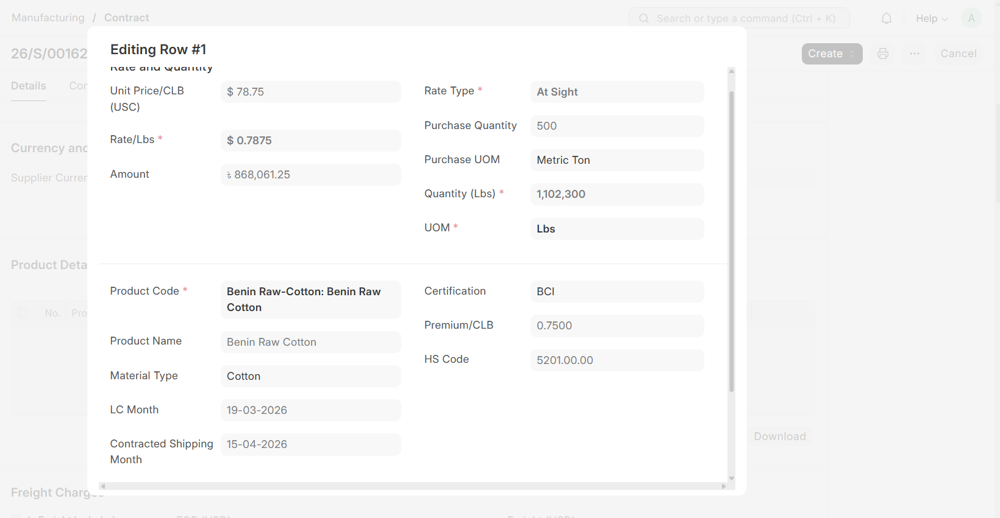
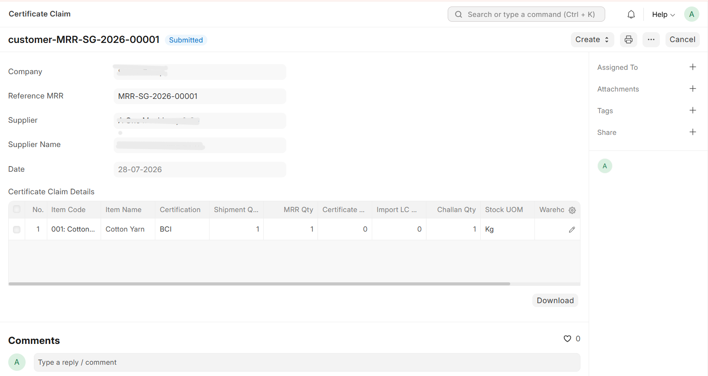
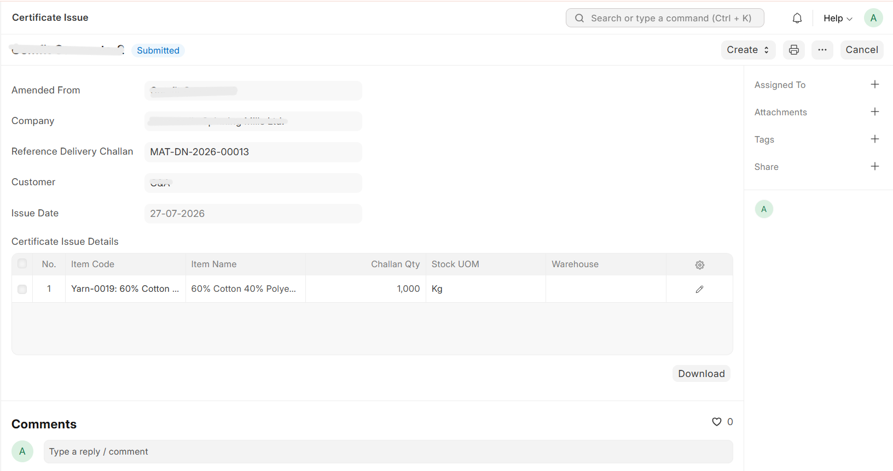
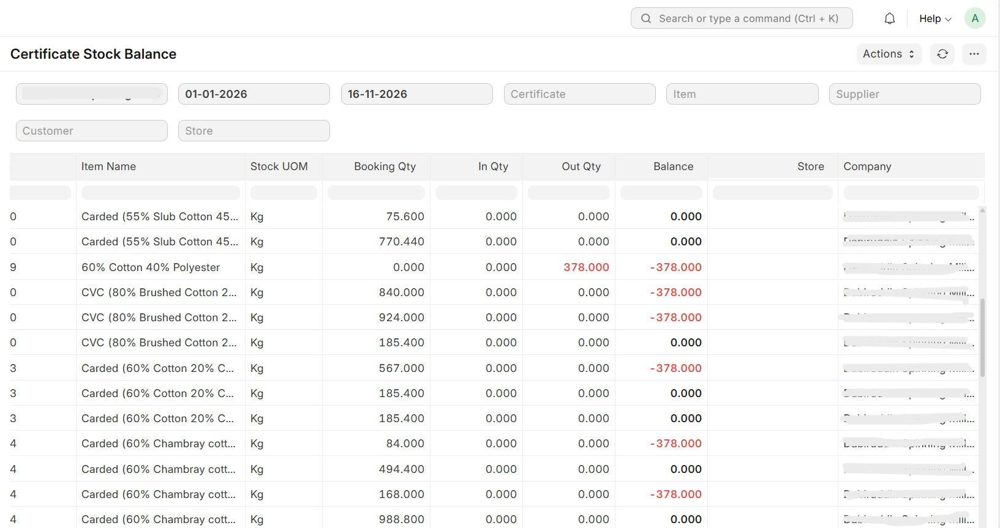

# Certificate Management

## 1. Import Management

### 1.1 Overview

Certificate Management is part of the Import process in Salma ERP. It is used to maintain certification information associated with imported materials and products.

The functionality supports certificate registration, certificate type configuration, linking certifications with imported products, and tracking certificate-related quantities through the import process.

### 1.2 Import Process Overview

The import process generally follows this sequence:

1. Contract
2. Price Fixation
3. Requisition
4. Purchase Order
5. Proforma Invoice
6. LC Application
7. Import LC
8. Shipment Document
9. Material Distribution
10. Material Receipt Report (MRR)

In some cases, the process may proceed directly from Shipment Document to MRR, without following every intermediate step.

After an MRR is submitted, a Certificate Claim document is automatically generated to maintain the related certificate claim information.

### 1.3 Certificate Management

The Certificate DocType is used to maintain certification records associated with imported materials and products.

It includes the following information:

- **Certificate Information:** Certificate name, certificate number, and certificate type.
- **Validity Information:** Issue date, validity period, renewal date, and certificate status.
- **Quantity Information:** Certificate quantity, unit of measurement (UOM), and wastage percentage.
- **Issuing Information:** Issuing authority and relevant department.
- **Importer Information:** Importer details and relevant registration information.
- **Product Details:** Products associated with the certificate, including LC number, product code, product name, supplier, and HS code.
- **Attachments:** Supporting documents such as permit copies, application forms, and authority certificates.

### 1.3.1 Certificate Type

The Certificate Type DocType is used to define and maintain different types of certificates. For example, BCI-Slub is configured as a certificate type, with an associated wastage percentage.

### 1.4 Certificate Integration with Import Documents

Certification information is associated with imported products during the import process.

In the Contract document, the Product Details child table includes a Certification field. This allows a certification type, such as BCI, to be associated with a particular product row.

As the import process continues through subsequent documents, product-related information and quantities are maintained across the relevant document records. Depending on the document and transaction, product quantities may be represented across multiple rows.

#### Contract – Product Certification

*Figure 1: Certification field in the Product Details child table of the Contract.*

### 1.5 Certificate Claim

Certificate Claim is used to maintain certificate-related quantity information against a submitted Material Receipt Report (MRR).

When an MRR is submitted, the system automatically generates a corresponding Certificate Claim document.

The Certificate Claim Details child table contains information such as:

- Item Code and Item Name
- Certification
- Shipment Quantity
- MRR Quantity
- Certificate Quantity
- Import LC Quantity
- Challan Quantity
- Stock UOM
- Warehouse
- Claim Quantity

This information helps track the relationship between imported product quantities, received quantities, and certificate-related claims.

#### Certificate Claim

*Figure 2: Certificate Claim document showing item-wise certification and quantity details.*

## 2. Sales Management

### 2.1 Overview

The Sales module in Salma ERP supports the management of export sales transactions, from Proforma Invoice (PI) references to delivery-related activities.

The process includes Sales PI, Export LC, Delivery Order, and Delivery Challan. It also includes certificate-related functionality to track certificate quantities against delivered products.

### 2.2 Sales Process Overview

The general sales process follows this sequence:

1. Sales PI
2. Export LC
3. Delivery Order
4. Delivery Challan
5. Certificate Issue

A Delivery Order is created with reference to the relevant sales information, including PI and Export LC details. Delivery Challan is then used to record the actual delivery against the order.

### 2.3 Certificate Configuration in Sales

The Certificate and Certificate Type configurations maintained in the Import module are also used in Sales-related certificate operations.

The configured certificate types, percentages, and wastage information are utilized during Certificate Issue generation to calculate certificate quantities against delivered products.

### 2.4 Sales PI and Delivery Order

Sales PI contains the commercial and product-related information required for export sales transactions.

The Delivery Order (Sales Order) maintains delivery-related information against the PI and Export LC.

Key information includes:

- Customer/Buyer and company information
- Order confirmation and shipment dates
- Production type and Delivery Order type
- Item details, yarn count, quantity, rate, and amount
- Delivery warehouse and stock reservation
- Sales PI amount and Export LC amount
- PI History and Export LC History
- Delivered and remaining quantities and amounts

The PI and Export LC history sections help track the relationship between the original sales quantity, LC quantity, delivered quantity, and remaining balance.

### 2.5 Certificate Issue

Certificate Issue maintains certificate quantities associated with delivered products.

When a Delivery Challan is submitted, the system automatically generates a corresponding Certificate Issue document.

The Certificate Issue document includes:

- Reference Delivery Challan
- Customer and issue date
- Item code and item name
- Challan quantity and stock UOM
- Warehouse
- Certificate type and percentage
- Certificate quantity breakdown
- Wastage percentage
- Certificate Claim quantity
- Available quantity

#### Certificate Quantity Calculation

The system calculates certificate-related quantities based on the delivered item quantity, certificate percentage, and applicable wastage.

When multiple entries relate to the same certificate, their quantities are accumulated to maintain a cumulative issue quantity.

The system also considers the Certificate Claim quantity and calculates the available balance.

**Available Quantity = Certificate Claim Quantity − Certificate Issue Quantity**

Since Certificate Issue represents certificate quantity used against deliveries, the issue quantity reduces the available balance.

#### Certificate Issue

*Figure 3: Automatically generated Certificate Issue document showing certificate quantity breakdown, wastage, claim quantity, and available balance.*

## 3. Certificate Stock Balance Report

The Certificate Stock Balance report provides a consolidated view of certificate-related quantity movements associated with sales and delivery transactions.

It tracks certificate quantities from Sales PI booking through Certificate Claim and Certificate Issue, helping users monitor the certificate stock position for different items.

### How the Report Maintains Certificate Quantities

The report maintains quantity information from three major transaction sources:

- **Booking Qty – Sales PI:** Represents the certificate quantity booked against Sales PI. It reflects the certificate requirement associated with the sales transaction.
- **In Qty – Certificate Claim:** Represents the certificate quantity received or added through Certificate Claim transactions.
- **Out Qty – Certificate Issue:** Represents the certificate quantity issued against delivered products through Certificate Issue transactions. Certificate Issue is automatically generated when a Delivery Challan is submitted.

The report uses these transaction records to present the certificate quantity movement and corresponding balance for each item.

### Report Columns

- **Item Name:** Product associated with the certificate quantity.
- **Stock UOM:** Unit of measurement, such as Kg.
- **Booking Qty:** Quantity booked through Sales PI.
- **In Qty:** Quantity recorded through Certificate Claim.
- **Out Qty:** Quantity recorded through Certificate Issue.
- **Balance:** Certificate stock balance based on the relevant quantity transactions.
- **Store:** Associated warehouse or storage location.
- **Company:** Company associated with the record.

Users can filter the report by Company, Date Range, Certificate, Item, Supplier, Customer, and Store/Warehouse to review certificate quantity movements for specific business requirements.

The report also provides a consolidated total of Booking Qty, In Qty, Out Qty, and Balance at the bottom, allowing users to review the overall certificate stock position.

Negative balances are highlighted in red to help identify negative certificate stock positions.

#### Certificate Stock Balance Report

*Figure 4: Certificate Stock Balance report showing certificate quantities booked through Sales PI, received through Certificate Claim, issued through Certificate Issue, and the resulting balance.*

## 4. Confidentiality

All screenshots must be anonymized before public publication. Company, importer, supplier, customer, employee, and contact details, sensitive certificate numbers, Certificate Issue and Certificate Claim references, LC and transaction references, financial values, account details, and other confidential business information must be hidden or replaced with sample data.

Relevant interface elements, field labels, and functional details may remain visible to demonstrate the system's features.
