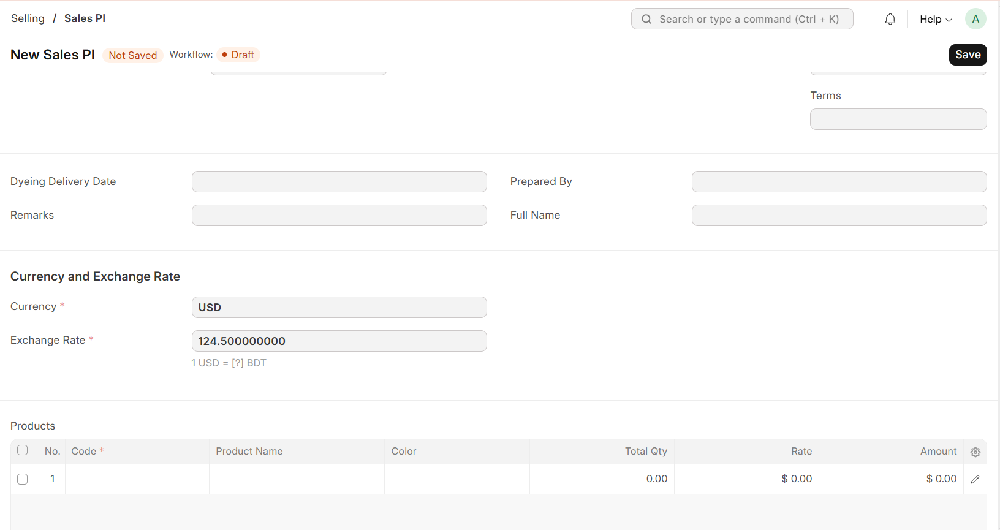
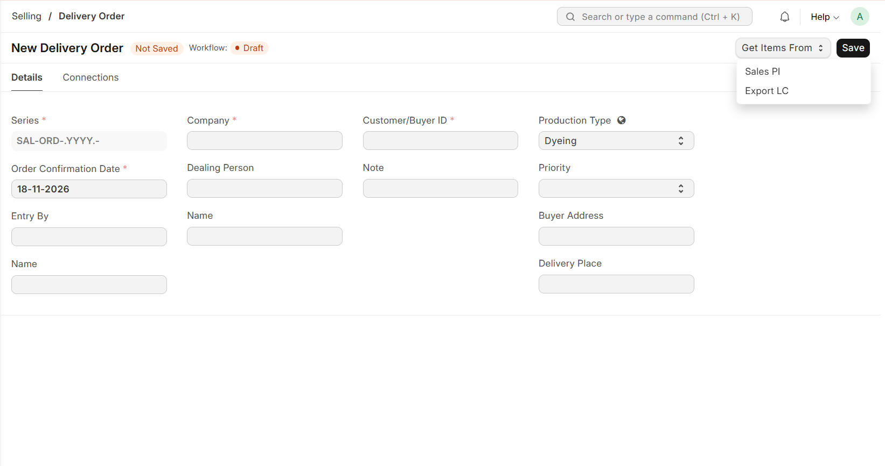
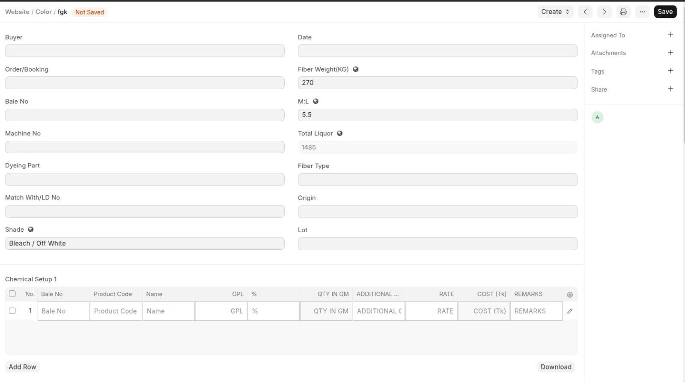
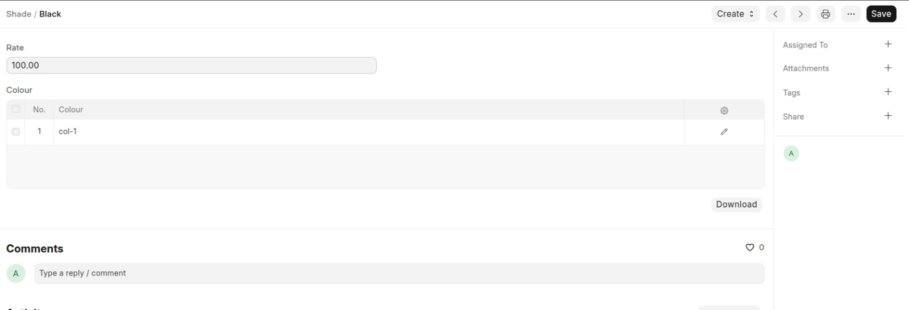
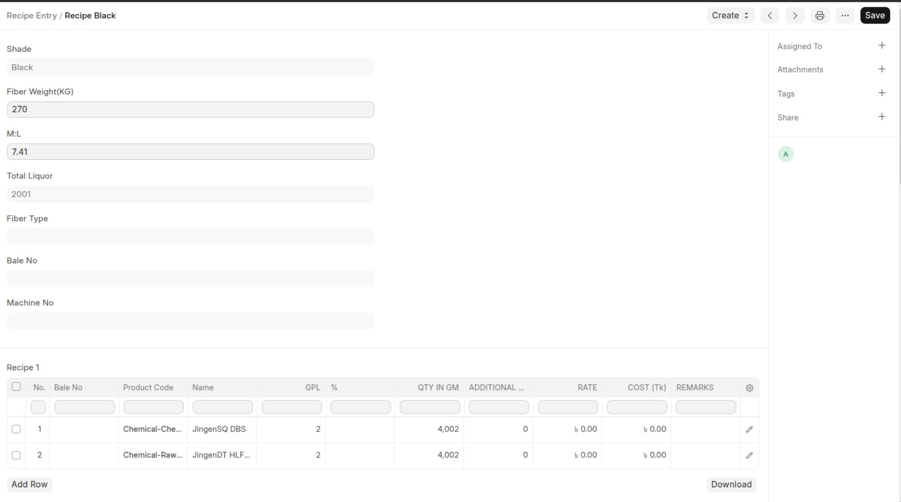
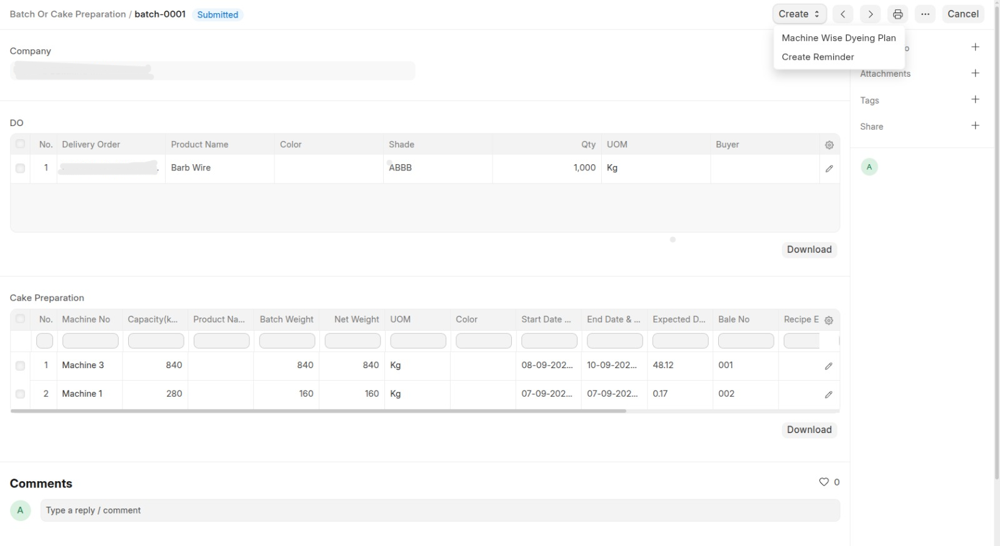
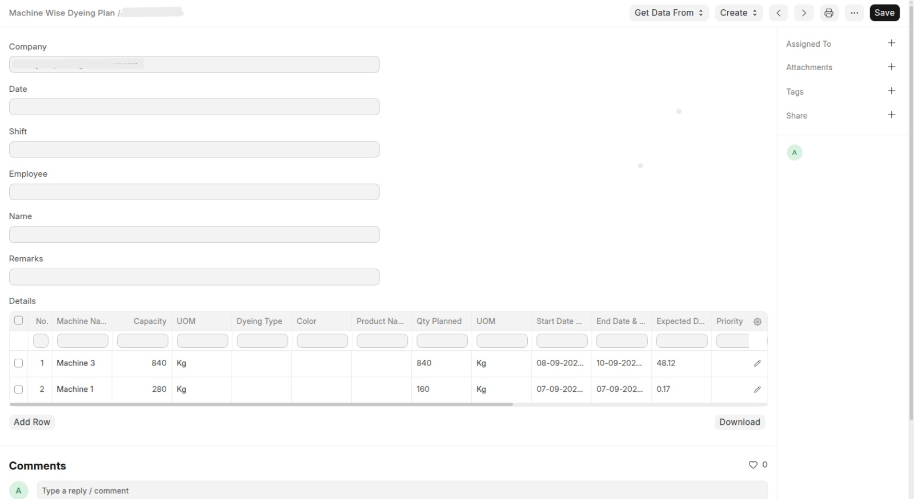
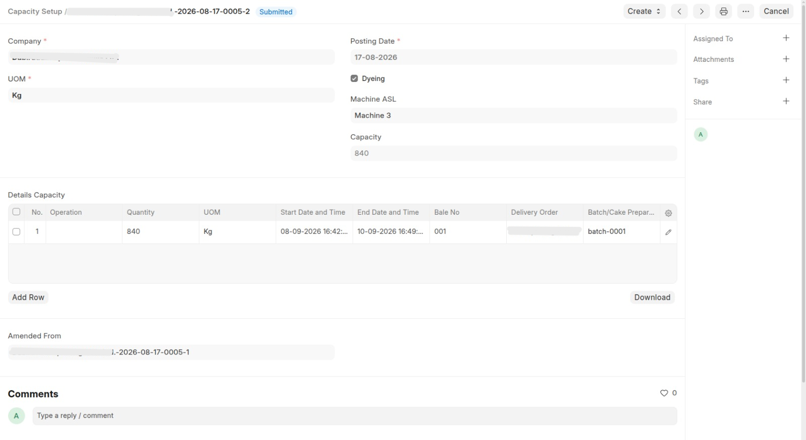

# Dyeing Management Module

## 1. Module Overview

The Dyeing Management module in Salma ERP supports the planning and preparation of dyeing operations, from sales order information to machine-wise production scheduling.

The module includes Sales PI, Delivery Order, Color and Shade Management, Recipe Entry, Batch or Cake Preparation, Machine Wise Dyeing Plan, and Capacity Setup.

The implemented functionality focuses on preparing dyeing batches, managing color recipes, distributing batch quantities across available machines, and scheduling machine operations based on machine capacity, availability, and time slots.

My development contributions in this module cover the workflow from Sales PI through Batch or Cake Preparation, Machine Wise Dyeing Plan, and Capacity Setup.

## 2. Dyeing Workflow Overview

The implemented Dyeing workflow generally follows this sequence:

1. Sales PI
2. Delivery Order (DO)
3. Color and Shade Configuration
4. Recipe Entry
5. Batch or Cake Preparation
6. Machine Wise Dyeing Plan
7. Capacity Setup

These documents work together to organize dyeing requirements, prepare batches, allocate quantities across machines, and schedule operations based on machine capacity and available time.

## 3. Sales PI

Sales PI is the starting point of the Dyeing sales process.

The Sales PI document supports different Order Types, including Dyeing and Sales. The selected Order Type determines which relevant fields and information are displayed.

When the Order Type is set to Dyeing, dyeing-related information and fields are displayed for entering the required transaction details.

Key information includes:

- Customer/Buyer and Company
- PI Number and PI Date
- Dyeing Delivery Date
- Currency and Exchange Rate
- Product Details
- Product Color
- Quantity, Rate, and Amount
- Remarks and Prepared By

The product information entered in the Sales PI is used as the basis for preparing the subsequent Delivery Order.

**Screenshot: Sales PI**

*Figure 1: Sales PI with Dyeing selected as the Order Type and its related product information.*

## 4. Delivery Order (DO)

The Delivery Order maintains delivery-related information based on the Sales PI.

It includes a **Get Data From** option that allows users to select an existing Sales PI and retrieve its relevant information.

When a Dyeing Sales PI is selected, the corresponding product information is fetched into the Delivery Order.

Key information includes:

- Order Confirmation Date
- Company and Customer/Buyer
- Production Type
- Priority
- Buyer Address and Delivery Place
- Product and Delivery Details

The Priority field helps indicate the scheduling importance of an order.

The Delivery Order serves as the source document for Batch or Cake Preparation.

**Screenshot: Delivery Order**

*Figure 2: Delivery Order showing the Get Data From option and retrieved Sales PI information.*

## 5. Color and Shade Management

Color and Shade management supports the organization of dyeing colors and their associated recipes.

### 5.1. Color

The Color document maintains color-related information, including:

- Shade
- Rate
- Associated colors

A color can be associated with a Shade. When a color is saved with a selected Shade, it is automatically added to the child table of the corresponding Shade document.

This allows users to view multiple colors associated with a particular Shade from the Shade document.

**Screenshot: Color**

*Figure 3: Color document showing its Shade selection and associated color details.*

### 5.2. Shade

The Shade document groups and maintains related colors.

Its child table displays the colors associated with that Shade, providing a centralized view of the available color options.

**Screenshot: Shade**

*Figure 4: Shade document displaying the associated colors in its child table.*

### 5.3. Recipe Entry

Recipe Entry maintains the chemical and dyeing material requirements for a particular color recipe.

The recipe information is fetched from the corresponding Color document. Recipe Entry works with the existing Color record rather than creating a separate duplicate Color record.

When relevant recipe information is changed through Recipe Entry, the corresponding information in the original Color document is also updated.

Recipe-related information includes:

- Recipe Name and Shade
- Fiber Weight
- M:L (Material-to-Liquor Ratio)
- Total Liquor
- Fiber Type
- Bale Number and Machine Number
- Chemical and Dye Setup Details
- GPL and Percentage
- Quantity in Grams
- Additional Quantity
- Rate and Cost
- Dyeing Water and Dyeing Quantity

Multiple recipe sections can be maintained to organize the chemicals and dyes required for different stages of the dyeing process.

The selected color recipe is used during Batch or Cake Preparation.

**Screenshot: Recipe Entry**

*Figure 5: Recipe Entry showing recipe details and chemical/dye setup information.*

## 6. Batch or Cake Preparation

Batch or Cake Preparation is used to organize the quantities received from a Delivery Order into machine-wise dyeing batches.

Users can retrieve Delivery Order information and prepare the required batch quantities based on available machine capacities and schedules.

### 6.1. Delivery Order Information

The document retrieves relevant information from the selected Delivery Order, including:

- Delivery Order Reference
- Product Name
- Color
- Shade
- Quantity
- UOM
- Buyer

### 6.2. Machine-wise Cake Preparation

The Cake Preparation child table contains the machine-wise distribution of the required quantity.

Important fields include:

- Machine Number
- Machine Capacity
- Product Name
- Batch Weight
- Net Weight
- UOM
- Color
- Start Date and Time
- End Date and Time
- Expected Duration
- Bale Number
- Recipe Entry
- Delivery Order
- Operation
- Buyer
- Remarks

The system automatically splits the required quantity into suitable machine-wise batches based on machine capacity and availability.

During this process, machine scheduling information is also maintained. The Start Date and Time and End Date and Time specify the planned operating period for each machine allocation, while Expected Duration indicates the estimated time required for the operation.

The system considers existing machine schedules and available time slots when distributing batch quantities. This helps allocate work according to machine availability and reduce unnecessary waiting time.

### 6.3. Machine Summary

The document also provides a machine summary to help users review the machine-wise batch distribution and scheduling information.

The summary includes relevant machine allocation and scheduling details.

**Screenshot: Batch or Cake Preparation**

*Figure 6: Batch or Cake Preparation showing Delivery Order information and machine-wise cake allocation, including scheduled start and end times.*

## 7. Machine Wise Dyeing Plan

Machine Wise Dyeing Plan is used to review and manage the scheduled dyeing operations for individual machines.

The information is populated from the Batch or Cake Preparation document.

It provides a machine-wise view of the planned dyeing activities, including their quantities, schedules, and priorities.

Key information includes:

- Company
- Date and Shift
- Employee
- Machine Name
- Machine Capacity
- Dyeing Type
- Color
- Product Name
- Planned Quantity
- Start Date and Time
- End Date and Time
- Expected Duration
- Priority
- Bale Number
- Delivery Order
- Buyer
- Origin and Status
- Remarks

The Priority field helps determine the order in which dyeing jobs should be scheduled.

The Start Date and Time, End Date and Time, and Expected Duration help users review when each machine is scheduled to perform an operation and how long the operation is expected to take.

This document allows users to review machine assignments, planned quantities, priorities, and operating time slots.

**Screenshot: Machine Wise Dyeing Plan**

*Figure 7: Machine Wise Dyeing Plan showing machine assignments, planned quantities, priorities, and scheduled operating times.*

## 8. Capacity Setup

Capacity Setup maintains machine-wise capacity and scheduling information.

Machine records are configured with their respective capacities, which are used during batch distribution and machine scheduling.

### 8.1. Machine Capacity Information

Capacity Setup includes:

- Company
- UOM
- Posting Date
- Dyeing Operation
- Machine
- Machine Capacity

### 8.2. Machine-wise Capacity Details

The Details Capacity child table maintains the machine's scheduled operations and allocated quantities.

It includes:

- Operation
- Quantity
- UOM
- Start Date and Time
- End Date and Time
- Bale Number
- Delivery Order
- Batch/Cake Preparation Reference

### 8.3. Capacity Update and Scheduling

When a Batch or Cake Preparation document is submitted, the corresponding machine allocation and scheduling information is reflected in Capacity Setup.

The system considers existing machine schedules, allocated capacity, and operating time slots when distributing batch quantities.

By reviewing the scheduled start and end times, users can identify:

- Which machines are already scheduled
- When a machine is expected to become available
- How much capacity is available
- Which time slots can accommodate additional dyeing batches

This helps users monitor machine utilization, plan subsequent batches, and reduce unnecessary idle time during dyeing production planning.

**Screenshot: Capacity Setup**

*Figure 8: Capacity Setup showing machine capacity, allocated quantities, scheduled operations, and time information.*

## 9. Development Scope

My development work in the Dyeing Management module covers the process from Sales PI through machine-wise planning and capacity management.

The documented scope includes:

- Dyeing-specific Sales PI information
- Delivery Order data retrieval from Sales PI
- Color and Shade management
- Recipe Entry and synchronization with the original Color document
- Batch or Cake Preparation
- Automatic machine-wise batch distribution based on capacity and availability
- Machine scheduling with start time, end time, and expected duration
- Machine Wise Dyeing Plan
- Machine capacity management and Capacity Setup updates

The subsequent production processes, including Job Card creation and further production execution activities, are outside the scope of my contributions documented here.

## 10. Confidentiality

All screenshots must be anonymized before public publication. Company, customer, buyer, supplier, employee, and contact details, document references, product-specific commercial information, financial values, machine-related confidential information, and other sensitive business data must be hidden or replaced with sample data.

Relevant field labels, workflow steps, and functional details may remain visible to demonstrate the module's features.
