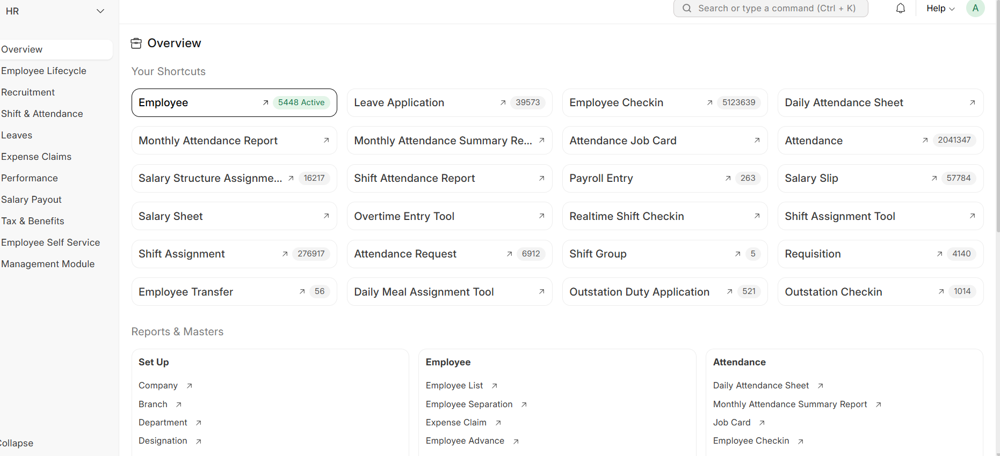

# HR Management Module

## 1. Module Overview

The HR Management module is one of the key functional areas of Salma ERP.

It supports human resource management activities, with a focus on recruitment processes and employee lifecycle management.

The module includes standard ERPNext HR functionalities along with project-specific customizations developed to meet business requirements.The HR module provides a centralized workspace for managing various human resource operations within Salma ERP.

It brings together key HR functionalities, including Employee Management, Employee Lifecycle, Recruitment, Leave Management, Shift & Attendance, and other HR-related operations.

The HR workspace provides quick access to frequently used features, reports, and master data.

HR Workspace Overview

The following screenshot shows the HR workspace dashboard and its available functional areas.

Figure 1: HR workspace dashboard of Salma ERP.

## 2. Functional Areas

My primary development contributions in this module focus on the following areas:

### 2.1 Recruitment Management

Recruitment Management supports activities related to the hiring process.

The relevant functional areas include:

- Job Opening Management
- Job Applicant Management
- Recruitment-related information and records
- Interview-related activities, where applicable

**My Contributions:**

- Developed and customized recruitment-related functionalities.
- Worked with relevant DocTypes and business logic.
- Implemented frontend and backend customizations based on assigned requirements.

**Screenshots:**

Add approved screenshots of the recruitment features below.

*Figure 1: Job Opening interface.*

*Figure 2: Job Applicant interface.*

### 2.2 Employee Lifecycle Management

Employee Lifecycle Management focuses on employee-related processes and information throughout the employment journey.

**My Contributions:**

- Worked on employee lifecycle-related functionalities.
- Customized relevant forms and DocTypes.
- Implemented required business logic and validations.
- Worked on related workflows and permissions, where applicable.

**Screenshots:**

*Figure 3: Employee List interface.*

*Figure 4: Employee Form interface.*

## 3. Technical Implementation

The HR module development involved the following technologies and implementation areas, where applicable:

| Area | Technology |
|---|---|
| Framework | Frappe Framework |
| ERP Platform | ERPNext |
| Backend Development | Python |
| Frontend Development | JavaScript |
| Database | MariaDB |
| Templates | Jinja |

### Technical Work

- Custom DocType development and customization.
- Python-based server-side logic.
- JavaScript-based client-side scripting.
- API development using Frappe whitelisted methods.
- Workflow and permission customization.
- Form customization and validation.
- Reports and Print Format customization, where applicable.

## 4. Workflow and Process Diagrams

The following diagrams can be added to illustrate the relevant HR processes.

### Recruitment Workflow

*Figure 5: High-level recruitment workflow.*

### Employee Lifecycle Workflow

*Figure 6: High-level employee lifecycle workflow.*

## 5. Summary of My Contributions

My primary focus within the HR module has been Recruitment Management and Employee Lifecycle development.

My responsibilities included implementing assigned requirements, customizing existing ERPNext functionalities, and contributing to backend and frontend development using the Frappe Framework.

## 6. Confidentiality

All screenshots and diagrams included in this documentation must be approved for public sharing and anonymized where necessary.

No confidential company information, personal employee records, candidate information, or proprietary source code should be exposed.
