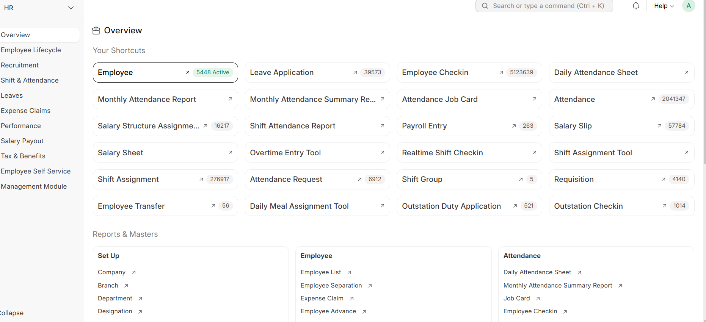
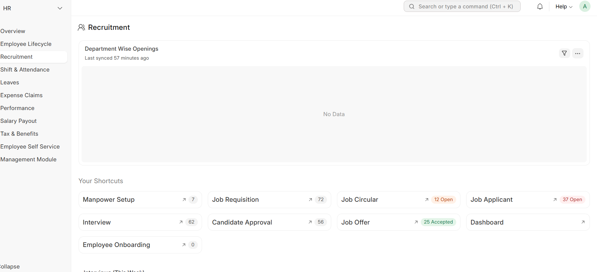
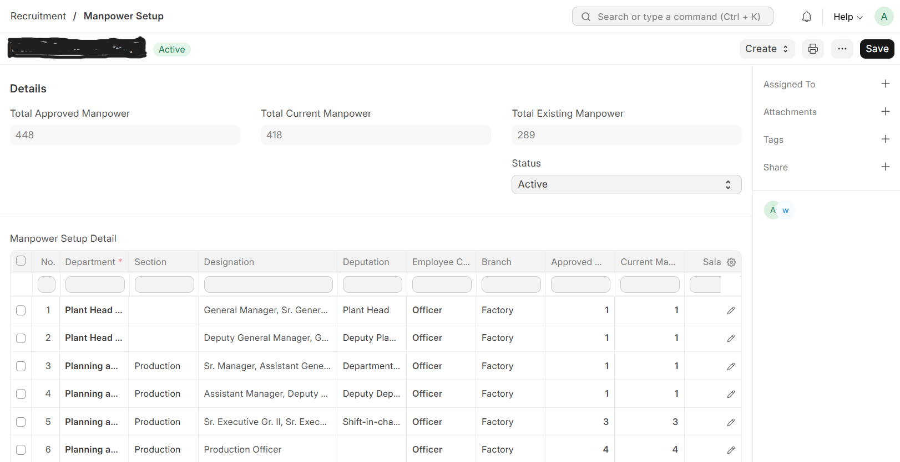
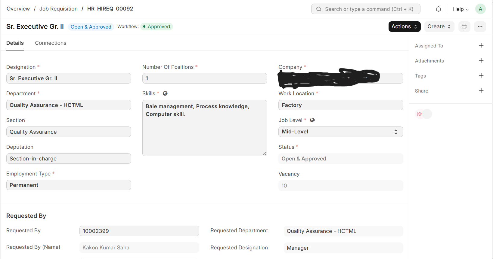
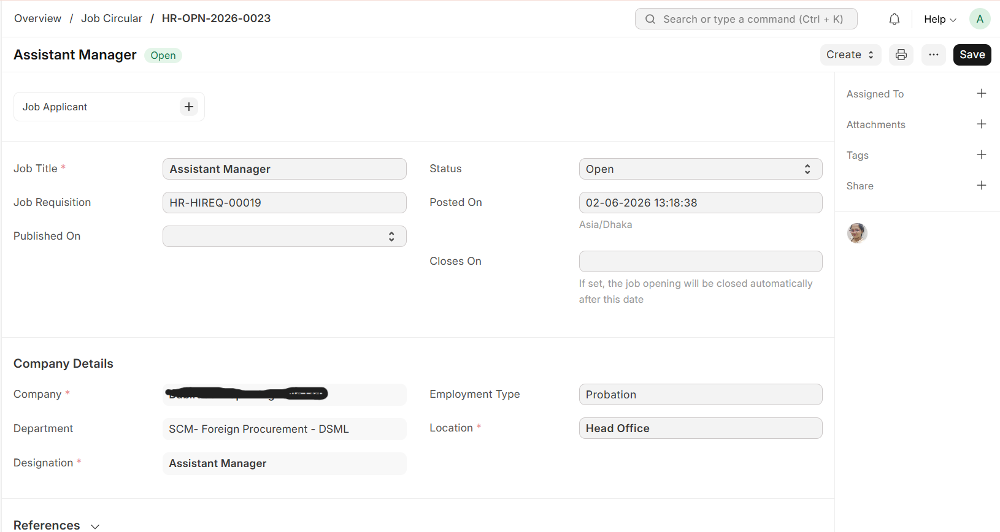
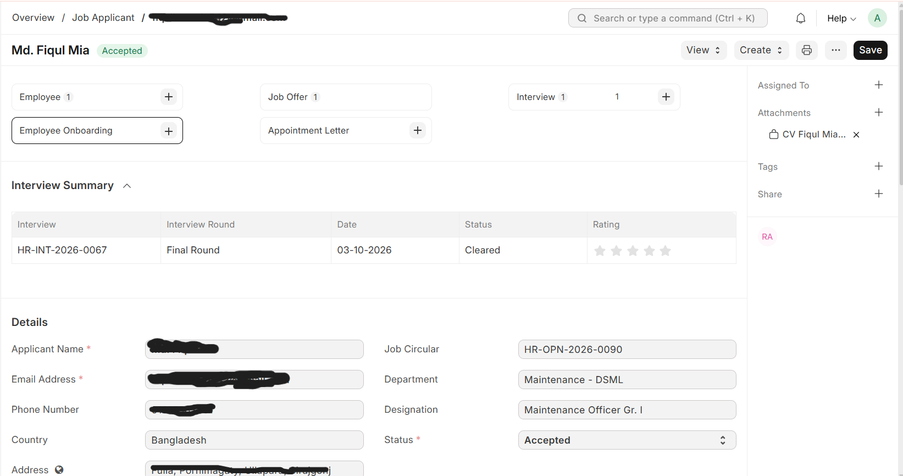
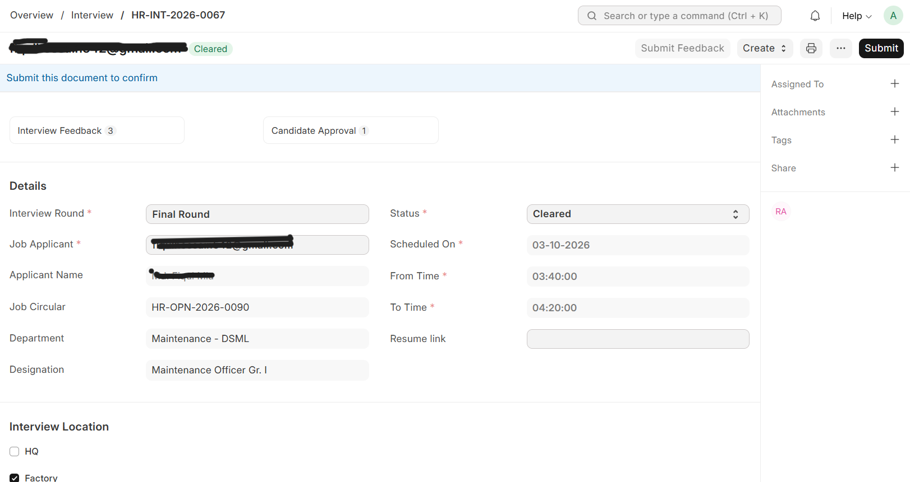
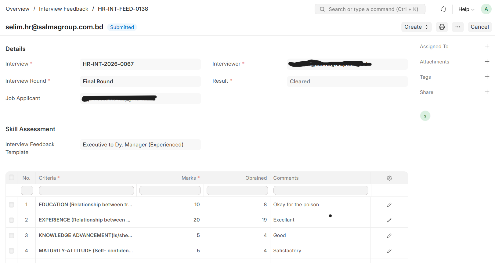

# HR Management Module

## 1. Module Overview

The HR Management module is one of the key functional areas of Salma ERP.

It supports human resource management activities, with a focus on recruitment processes and employee lifecycle management.

The module includes standard ERPNext HR functionalities along with project-specific customizations developed to meet business requirements.The HR module provides a centralized workspace for managing various human resource operations within Salma ERP.

It brings together key HR functionalities, including Employee Management, Employee Lifecycle, Recruitment, Leave Management, Shift & Attendance, and other HR-related operations.

The HR workspace provides quick access to frequently used features, reports, and master data.

HR Workspace Overview

The following screenshot shows the HR workspace dashboard and its available functional areas.

Figure 1: HR workspace dashboard of Salma ERP.

## 2. Functional Areas

My primary development contributions in this module focus on the following areas:

### 2.1 Recruitment Management

Recruitment Management covers the hiring process, from manpower planning and job requisition to candidate selection and onboarding.

The relevant functional areas include:

- Manpower Setup
- Job Requisition
- Job Circular
- Job Applicant Management
- Interview Management
- Candidate Approval
- Job Offer Management
- Employee Onboarding

**My Contributions:**

- Developed and customized recruitment-related DocTypes and functionalities.
- Worked on manpower setup and job requisition processes.
- Implemented customizations for job circular and applicant management.
- Worked on interview and candidate approval processes.
- Contributed to job offer and employee onboarding functionalities.
- Implemented frontend and backend customizations based on assigned requirements.
**Screenshots:**

The following screenshot shows the Recruitment workspace and its key functional areas.

*Figure 2: Recruitment workspace dashboard of Salma ERP.*

#### 2.1.1 Manpower Setup

Manpower Setup is used to organize and monitor workforce requirements across different departments and designations.

It maintains manpower information based on organizational structure, including department, section, designation, employee category, and branch.

**Key Functionalities:**

- Department-wise and designation-wise manpower planning.
- Tracking approved manpower and current manpower.
- Monitoring existing manpower.
- Identifying vacant positions based on manpower requirements.
- Maintaining salary range information for designated positions.
- Organizing manpower details by employee category and branch.

The following screenshot illustrates the Manpower Setup interface, including manpower summary information and the detailed manpower table.

*Figure 2: Manpower Setup interface showing workforce planning and manpower details.*

#### 2.1.2 Job Requisition

Job Requisition is used to initiate and manage requests for new or replacement employees across different departments.

It captures position details, required qualifications, skills, experience, salary range, hiring justification, and approval status. It also supports a workflow for reviewing and approving hiring requests.

*Figure 3: Job Requisition form showing hiring requirements and approval workflow.*

#### 2.1.3 Job Circular

Job Circular is used to create and manage job openings based on recruitment requirements.

It contains job details, including designation, department, employment type, location, job description, salary range, and publication status. It also supports publishing job openings on the website and setting application deadlines.

*Figure 4: Job Circular form showing job opening details and publication settings.*

#### 2.1.4 Job Applicant

Job Applicant is used to manage candidate information and track applications for published job openings.

It stores applicant details, contact information, resume, salary expectations, and application status. It also displays related interview information and hiring progress.

*Figure 5: Job Applicant form showing candidate information, application status, and interview summary.*

#### 2.1.5 Interview

Interview doc is used to schedule and track candidate interviews throughout the recruitment process.

It maintains interview rounds, scheduled dates and times, interview locations, assigned interviewers, and interview status. Interview feedback and results can also be recorded for candidate evaluation.

*Figure 6: Interview form showing interview scheduling, interviewers, and candidate evaluation status.*

#### 2.1.6 Interview Feedback

Interview Feedback is used to evaluate candidates based on predefined assessment criteria.

It records criteria-wise marks, interviewer comments, skill assessments, overall evaluation, candidate strengths, and areas for improvement. It also helps document the interview result and salary expectations.

*Figure 7: Interview Feedback form showing candidate assessment criteria and evaluation details.*

### 2.2 Employee Lifecycle Management

Employee Lifecycle Management focuses on employee-related processes and information throughout the employment journey.

**My Contributions:**

- Worked on employee lifecycle-related functionalities.
- Customized relevant forms and DocTypes.
- Implemented required business logic and validations.
- Worked on related workflows and permissions, where applicable.

**Screenshots:**

*Figure 3: Employee List interface.*

*Figure 4: Employee Form interface.*

## 3. Technical Implementation

The HR module development involved the following technologies and implementation areas, where applicable:

| Area | Technology |
|---|---|
| Framework | Frappe Framework |
| ERP Platform | ERPNext |
| Backend Development | Python |
| Frontend Development | JavaScript |
| Database | MariaDB |
| Templates | Jinja |

### Technical Work

- Custom DocType development and customization.
- Python-based server-side logic.
- JavaScript-based client-side scripting.
- API development using Frappe whitelisted methods.
- Workflow and permission customization.
- Form customization and validation.
- Reports and Print Format customization, where applicable.

## 4. Workflow and Process Diagrams

The following diagrams can be added to illustrate the relevant HR processes.

### Recruitment Workflow

*Figure 5: High-level recruitment workflow.*

### Employee Lifecycle Workflow

*Figure 6: High-level employee lifecycle workflow.*

## 5. Summary of My Contributions

My primary focus within the HR module has been Recruitment Management and Employee Lifecycle development.

My responsibilities included implementing assigned requirements, customizing existing ERPNext functionalities, and contributing to backend and frontend development using the Frappe Framework.

## 6. Confidentiality

All screenshots and diagrams included in this documentation must be approved for public sharing and anonymized where necessary.

No confidential company information, personal employee records, candidate information, or proprietary source code should be exposed.
