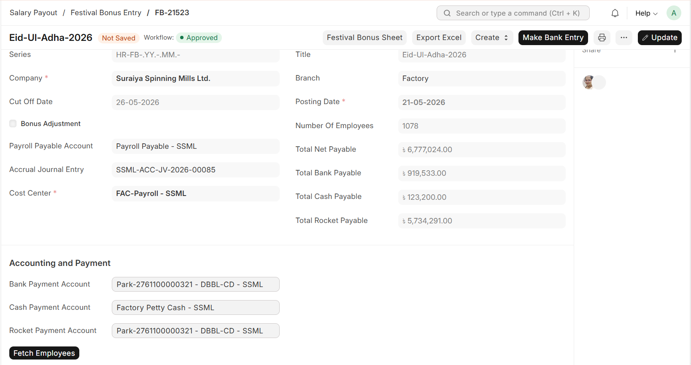

# Payroll Management Module

## 1. Module Overview

The Payroll Management module supports payroll-related operations within Salma ERP. It includes functionalities for managing employee salary information, salary slips, festival bonuses, and payroll-related accounting processes.

My development contributions primarily focus on Festival Bonus Entry and selected customizations in Salary Slip, particularly the Earning and Deduction sections.

## 2. Festival Bonus Entry

Festival Bonus Entry is used to manage festival bonus records for eligible employees.

The functionality supports:

- Creating festival bonus entries for a selected occasion.
- Setting the cut-off date and posting date.
- Retrieving employee information for bonus processing.
- Displaying employee details such as designation, department, joining date, and service duration.
- Managing disbursed and actual bonus percentages.
- Displaying gross salary and payable bonus amounts.
- Separating payable amounts by payment method, such as Bank, Cash, and Rocket.
- Summarizing total payable amounts by payment method.
- Maintaining payroll payable account and related accounting information.
- Supporting the approval workflow and accounting journal entry reference.

### My Contribution

I worked on the Festival Bonus Entry functionality, covering its everything like form structure, employee-related information, bonus details, payment breakdown, and related functionality.

**Screenshot: Festival Bonus Entry**

*Figure 1: Festival Bonus Entry form with employee bonus details and payment summary. All sensitive information must be anonymized in the public portfolio.*

## 3. Salary Slip Customization

Salary Slip is used to maintain employee salary information and earnings and deductions for payroll processing.

### My Contribution

I contributed to selected customizations in the Salary Slip, specifically working on the Earning and Deduction sections.

My work in this area was limited to these sections; the other Salary Slip functionalities were outside my contribution.

## 4. Confidentiality

All screenshots included in this documentation must be anonymized before publication. Employee names, IDs, salary information, bank details, account numbers, company-specific information, and other confidential data must not be exposed.
